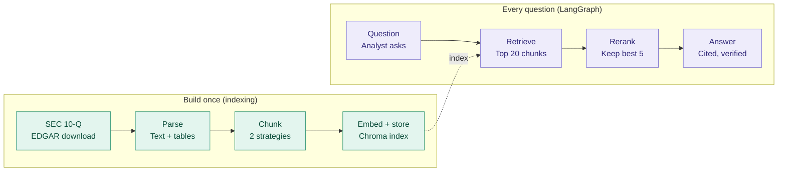

# acre-rag architecture

A RAG app that answers analyst questions about an SEC 10-Q filing, with citations.

It has two halves:

- **Indexing** runs **once** per filing and builds a searchable index.
- **Answering** runs **every time an analyst asks a question**.

## Diagram



Plain-text version (readable anywhere):

```
BUILD ONCE (indexing)
 [SEC 10-Q] --> [Parse] --> [Chunk] --> [Embed + store]
  EDGAR         text +      2            Chroma index
  download      tables      strategies        |
                                              |
EVERY QUESTION (LangGraph)                    v
 [Question] --> [Retrieve] --> [Rerank] --> [Answer]
  analyst       top 20         keep         cited,
  asks          chunks         best 5       verified
```

> To see the Mermaid diagram rendered in VS Code, install the
> "Markdown Preview Mermaid Support" extension and press `Ctrl+Shift+V`.
> GitHub renders it automatically.

## Stages

| # | Stage | What it does | Main tools |
|---|-------|--------------|------------|
| 1 | Download | Fetch the 10-Q from SEC EDGAR | `requests` (with `SEC_USER_AGENT`) |
| 2 | Parse | Pull out narrative text and financial tables | `beautifulsoup4`, `lxml`, `pandas` |
| 3 | Chunk | Split into passages; compare 2 strategies | `langchain-text-splitters`, `langchain-experimental` |
| 4 | Embed + store | Turn chunks into vectors, save to disk | `sentence-transformers`, `langchain-chroma` |
| 5 | Retrieve | Find the 20 chunks closest to the question | Chroma similarity search |
| 6 | Rerank | Re-score those 20, keep the best 5 | cross-encoder `ms-marco-MiniLM-L-6-v2` |
| 7 | Answer | A local LLM answers with citations; code checks the citations and numbers, and retries once if they fail | `phi4-mini` in Ollama via `langchain-ollama`, `langgraph` |
| 8 | Evaluate | Score answers against known questions | `eval/questions.json`, `notebooks/07_evaluate.ipynb` |
| 9 | UI | Simple app for analysts | `streamlit` (`app.py`) |

Everything runs locally and free: no API keys, and nothing leaves the laptop.

## Project layout

| Folder | Holds |
|--------|-------|
| `data/` | Downloaded filings, parsed output, Chroma index |
| `notebooks/` | Step-by-step experiments, one per stage |
| `src/` | Reusable code once a notebook step works: `pipeline.py` (the steps), `graph.py` (the LangGraph flow) |
| `eval/` | Test questions and expected answers |
| `reports/` | Results, charts, write-ups |
| `notes/` | Plain-language explanations of the concepts behind the project |
| `app.py` | The Streamlit app |

`.env` (project root, never committed) holds `SEC_USER_AGENT`. See `.env.example`.

## Progress

- [x] Environment set up (Python 3.12 venv, packages, `.gitignore`)
- [x] `00_setup_check`: imports, `.env` load, Ollama check
- [x] Download one 10-Q from EDGAR
- [x] Parse text and tables
- [x] Chunk with 2 strategies and compare
- [x] Embed and store in Chroma
- [x] Retrieve top 20
- [x] Rerank to best 5
- [x] LangGraph answer flow with citations and verification
- [x] Evaluation set and scores
- [x] Streamlit UI

## Staying focused

- One filing first. Add more only after the full pipeline works end to end.
- Finish a stage before polishing the previous one.
- Notebook first, then move working code into `src/`.
- Not in scope for v1: multiple companies, real-time feeds, user accounts, deployment.
